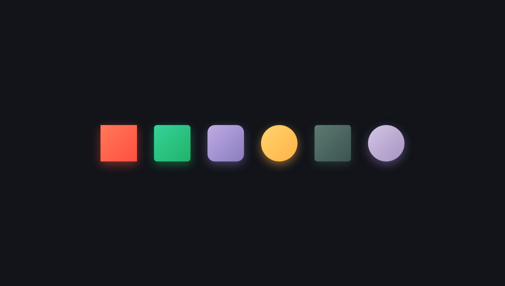

# 课后任务：CSS3 鼠标悬浮（hover）过渡效果练习

## 一、任务说明

- 页面文件：`work4/index.html`（单文件，内嵌 CSS，零 JavaScript）
- 任务要求：使用 CSS3 的 `transition`、`transform`、`box-shadow`、`border-radius`、`linear-gradient` 与 `:hover` 伪类，制作一组可在鼠标悬浮时产生反馈的色块。
- 完成时间：2026-10-06
- 预览地址：[国内 CDN](https://fwork.pgigi.com/work4) / [国外 CDN](https://fwork.pgg.wtf/work4)

效果截图：



## 二、技术要点

| 技术                           | 作用说明                                                                                       |
|--------------------------------|------------------------------------------------------------------------------------------------|
| `:hover` 伪类                  | 鼠标移入色块时切换状态，移出后自动还原，无需任何脚本。                                         |
| `transition`                   | 对 `transform` 与 `box-shadow` 做 `0.3s ease-out` 过渡，让上浮与阴影变化平滑而非瞬间跳变。     |
| `transform: translateY(-10px)` | 悬浮时色块整体上浮 10px，形成"被抬起"的立体反馈。                                              |
| `box-shadow`                   | 每个色块自带同色系辉光阴影；悬浮时加深为 `0 16px 40px rgba(0,0,0,.35)`，增强层次感。           |
| `border-radius`                | 用不同的圆角塑造三种形态：直角方块（0）、圆角方块（10px / 24px）与正圆（50%）。                |
| `linear-gradient`              | 135° 双色渐变填充，配合同色系阴影，让六个色块色彩各异。                                        |
| `::after` 伪元素               | 悬浮时淡入 "hover" 提示文字（`opacity` 过渡），用于可视化当前交互状态。                        |
| Flexbox 居中                   | `body` 与 `.stage` 使用 `display: flex` 完成水平垂直居中，`flex-wrap: wrap` 保证小屏自动换行。 |

## 三、六个色块说明

| 类名  | 形状        | 渐变配色                     |
|-------|-------------|------------------------------|
| `.c1` | 直角方块    | 珊瑚红 `#ff7a59 → #ff4f40`   |
| `.c2` | 10px 圆角   | 薄荷绿 `#36d399 → #20b26a`   |
| `.c3` | 24px 大圆角 | 藕紫 `#bface2 → #8a7cc1`     |
| `.c4` | 正圆        | 暖黄 `#ffd36e → #ffb347`     |
| `.c5` | 10px 圆角   | 灰绿 `#5c7a72 → #3b544f`     |
| `.c6` | 正圆        | 淡丁香紫 `#d4c5e5 → #a594c2` |

## 四、交互效果

1. **默认状态**：深色背景（`#12141a`）上横向排列六个 120×120 的彩色色块，各自带同色系辉光。
2. **鼠标悬浮**：色块上浮 10px，阴影加深扩散，同时淡入白色 "hover" 提示文字。
3. **移出还原**：过渡反向播放，色块平滑回到原位。

## 五、已知问题

- `.cube::after` 使用了 `position: absolute`，但 `.cube` 未声明 `position: relative`，因此 "hover" 文字会相对视口（初始包含块）定位，而不是相对色块居中；同时多个色块的提示文字会重叠在同一位置。
  修复方式：为 `.cube` 补充 `position: relative;`。

## 六、仓库说明

```
work4/
└── index.html              页面本体（单文件，内嵌 CSS，无 JS）
```

- 单文件结构，双击即可在浏览器打开预览，无需搭建服务器。
