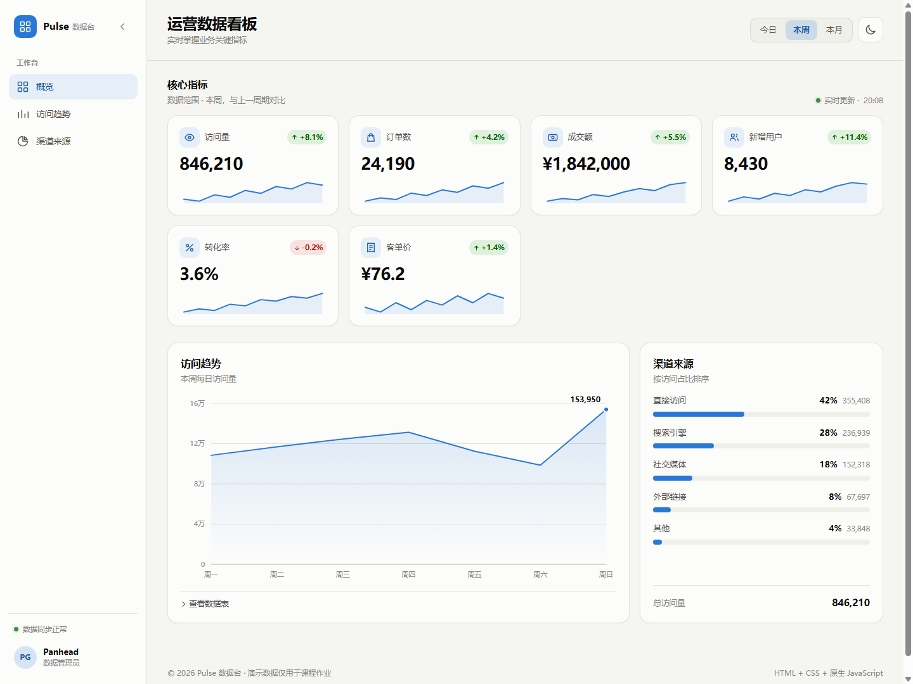
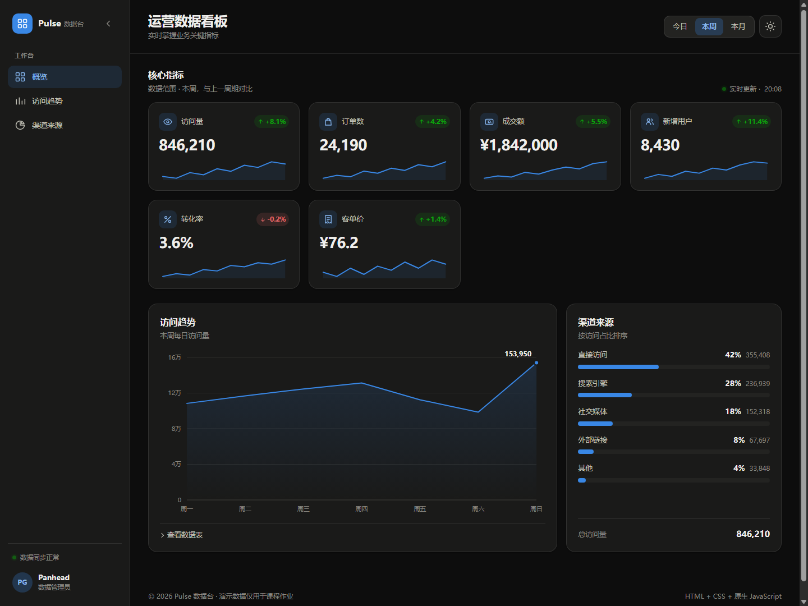

# 课后任务：响应式数据看板

## 一、任务说明

- 页面文件：`work5/index.html`（HTML 结构）、`work5/styles.css`（全部样式）、`work5/app.js`（原生 JavaScript）
- 任务要求：用 HTML + CSS + 原生 JS 做一个能在手机、平板、桌面三档宽度下正常使用的数据看板。
- 完成时间：2026-10-24
- 预览地址：[国内 CDN](https://fwork.pgigi.com/work5) / [国外 CDN](https://fwork.pgg.wtf/work5)

效果截图：



深色模式：



## 二、八项要求对照

| # | 要求 | 实现方式 |
|---|------|----------|
| 1 | 三个断点：<768 单列、768–1199 两列、≥1200 四列 + 侧栏 | 默认单列；`@media (min-width: 768px)` 两列；`@media (min-width: 1200px)` 四列 + 固定侧栏。侧栏在手机端为抽屉、平板端默认图标栏、桌面端默认展开，均可手动切换。断点已实际测量：767px 单列、768px 两列、1199px 两列、1200px 四列 + 侧栏。 |
| 2 | 卡片用 grid 的 `auto-fit` / `minmax()` 或 flex-wrap，不写死 `width: 1200px` | `.kpi-grid` 使用 `repeat(n, minmax(0, 1fr))`，宽度随视口伸缩；页面只设置 `max-width: 1600px`，没有固定 1200px 宽度。 |
| 3 | 320px–1920px 全区间无横向滚动条 | 所有网格子项设置 `min-width: 0`，图标/图表宽度自适应，`body` 与 `html` 使用 `overflow-x: clip` 兜底；已在 320 / 360 / 414 / 600 / 767 / 768 / 1024 / 1199 / 1200 / 1366 / 1600 / 1920 共 12 个宽度验证 `scrollWidth <= clientWidth`。 |
| 4 | 卡片的 6 条数据由 JS 数组渲染，不手写 6 段重复 HTML | `METRICS` 数组包含 6 个指标，`buildCards()` 遍历数组生成卡片；HTML 中只有一个空的 `#kpi-grid`。 |
| 5 | 数字使用 `font-variant-numeric: tabular-nums`，切换时不抖动 | 指标值、涨跌幅、图表刻度、表格与渠道数字均启用等宽数字；切换时间范围时用 `requestAnimationFrame` 做数字过渡，等宽数字保证位数变化时卡片不抖动。 |
| 6 | CSS 变量管理颜色，至少一组深/浅色可切换 | 全部颜色定义在 `:root`、`@media (prefers-color-scheme: dark)` 与 `:root[data-theme="dark"]` 中；顶栏按钮切换 `data-theme`，写入 `localStorage`。首次访问由 CSS 媒体查询直接生效，无需内联初始化脚本。 |
| 7 | 图片/图标有明确尺寸，图标用内联 SVG + `currentColor` | 所有图标都是内联 SVG，并带有显式 `width` / `height` 属性；线性图标统一 `stroke="currentColor"`，颜色随主题与上下文变化。 |
| 8 | 语义化：标题用 h1/h2，卡片区用 section，切换按钮用 button | `h1` 为看板标题，`h2` 为分区标题；卡片区为 `<section aria-labelledby>`；时间范围与主题切换均为 `<button>`，并带有 `aria-pressed` / `aria-label`。 |

## 三、功能与交互

1. **数据范围切换**：顶栏「今日 / 本周 / 本月」按钮同时更新 6 张指标卡、数值过渡动画、涨跌幅、趋势折线图、数据表与渠道总量。
2. **趋势折线图**：手写 SVG 绘制，含网格线、坐标轴、面积渐变、末点数值标签；鼠标移动时出现十字准线与跟随提示框，自动吸附最近的数据点。
3. **渠道条形图**：单色水平条，标注占比与该范围下的访问次数；悬停或键盘聚焦时显示气泡提示。
4. **数据表**：折线图下方的「查看数据表」可展开完整数据，方便不依赖鼠标的用户读取。
5. **主题切换**：浅色 / 深色即时切换，颜色全部通过 CSS 变量重算，图表无需重新绘制。
6. **可折叠侧栏**：
   - 手机（<768）：侧栏默认隐藏，点击左上角图标打开抽屉；点击遮罩、按 `Esc` 或点击导航项都会关闭，关闭后焦点回到打开按钮，并临时锁定页面滚动。
   - 平板（768–1199）：默认 76px 图标栏，只显示图标；点击侧栏顶部箭头展开为 232px 完整侧栏，再次点击收起，内容区同步让位。
   - 桌面（≥1200）：默认 232px 展开；点击箭头折叠为 76px 图标栏，再次点击恢复。
   - 折叠态保留 `aria-label`、`title` 与 `sr-only` 文本，键盘和屏幕阅读器仍可识别；跨断点缩放时回到该档默认状态。

## 四、技术要点

| 技术 | 说明 |
|------|------|
| HTML / CSS / JS 分离 | `index.html` 只负责语义结构，`styles.css` 负责主题与响应式，`app.js` 负责数据与交互；没有内联样式或内联脚本。 |
| 侧栏状态管理 | 手机用 `.is-open` 控制抽屉，平板/桌面用 `.is-collapsed` 控制图标栏；`matchMedia` 监听断点并同步 `aria-expanded` / `aria-label`。 |
| 焦点管理 | 抽屉打开后聚焦关闭按钮并限制 `Tab` 焦点范围；关闭时焦点回到左上角打开按钮。 |
| CSS Grid + `minmax()` | 三档断点下的卡片列数切换，窄屏不溢出。 |
| CSS 自定义属性 | 背景、表面、文字、边框、强调色、状态色与阴影统一由变量管理。 |
| `data-theme` + `localStorage` | 主题状态保存在根元素上，刷新后保持；首次访问由 `prefers-color-scheme` 媒体查询直接渲染。 |
| 原生 JS 数据渲染 | `METRICS` / `TREND` / `CHANNELS` 三个数据源驱动卡片、折线图、条形图与表格。 |
| 手写 SVG 图表 | 使用 `viewBox` 与像素级坐标计算；`ResizeObserver` 在容器尺寸变化时重绘。 |
| `tabular-nums` | 所有会随数据变化的数字使用等宽数字，避免切换时宽度跳动。 |
| 无障碍 | 跳转链接、`aria-pressed`、`sr-only` 文本、图表 `aria-label`、数据表替代视图、`prefers-reduced-motion` 降级。 |

## 五、文件结构

```
work5/
├── index.html    页面结构（语义化标签 + 内联 SVG）
├── styles.css    全部样式、主题变量与三档响应式断点
├── app.js        数据渲染、SVG 图表、主题与侧栏交互
└── README.md     课后任务文档
```

- 结构、样式、脚本分离，双击 `index.html` 即可在浏览器打开预览，无需构建工具或第三方依赖。
- 建议使用较新的 Chrome / Edge / Firefox / Safari 以完整支持 CSS 变量、Grid、`ResizeObserver` 与 `overflow-x: clip`。
- 已在 320 / 360 / 414 / 600 / 767 / 768 / 1024 / 1199 / 1200 / 1366 / 1600 / 1920 共 12 个宽度验证：无横向滚动；单列 / 两列 / 四列切换正确；手机抽屉、平板图标栏、桌面折叠 / 展开均正常。

## 六、提示词

用 HTML + CSS + 原生 JS，做一个能在手机、平板、桌面三档宽度下都正常使用的数据看板，要求：
1. 三个断点必须明确实现：<768 单列、768–1199 两列、≥1200 四列 + 侧栏
2. 卡片布局用 grid 的 auto-fit / minmax() 或 flex-wrap，不许写死 width:1200px
3. 页面在 320px～1920px 全区间不出现横向滚动条
4. 卡片的 6 条数据必须由 JS 数组渲染，不许手写 6 段重复 HTML
5. 数字使用 font-variant-numeric: tabular-nums，切换时不抖动
6. 用 CSS 变量管理颜色，至少一组深色/浅色可切换（可加分）
7. 图片/图标有明确尺寸，图标用内联 SVG + currentColor
8. 语义化：标题用 h1/h2，卡片区用 section，切换按钮用 <button>

- 手机＜768 单列堆叠
- 平板 768–1199 两列网格
- 桌面 ≥1200 固定侧栏 + 四列指标卡

- 将css、js和html分离，左边panel要可折叠。
- 低档位手机视图要隐藏边栏，但是可以点击左上图标展开；
- 中档位折叠边栏，展示边栏图标，但也要可展开；
- 最大挡位展开边栏，但要可折叠